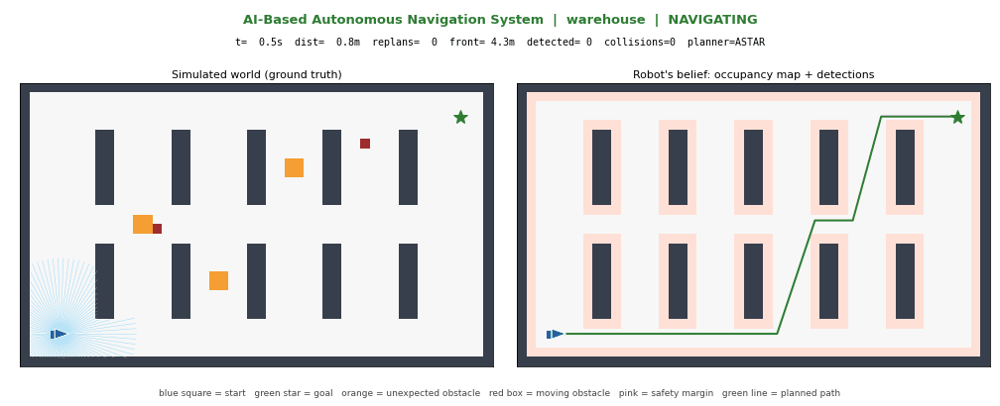
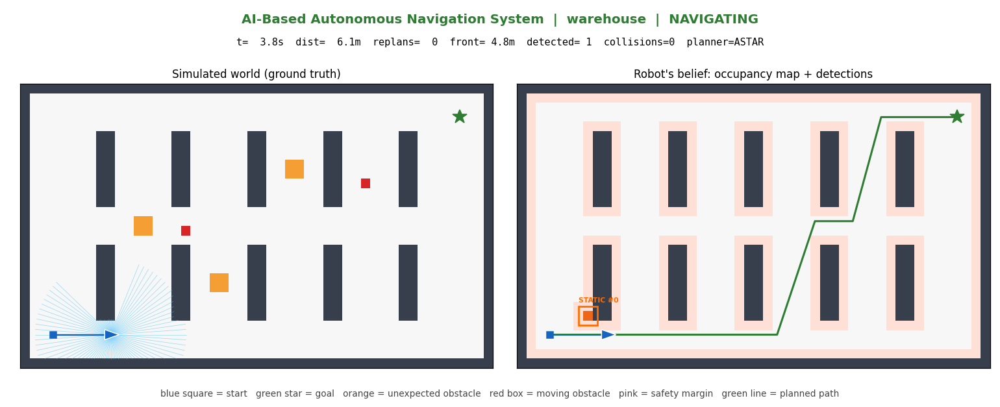
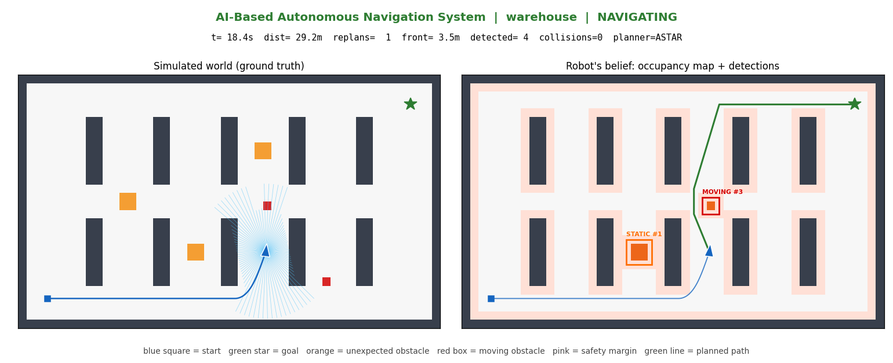
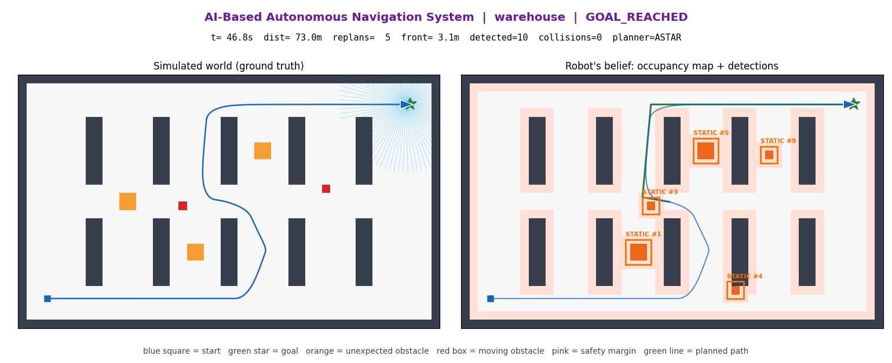
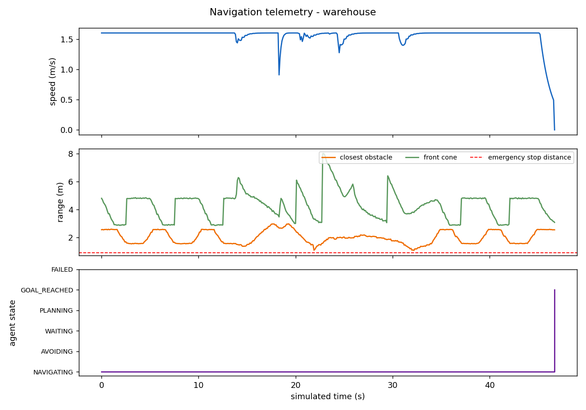
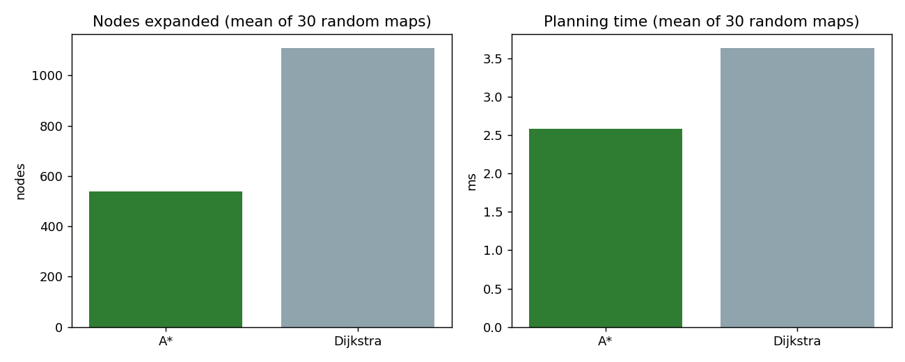
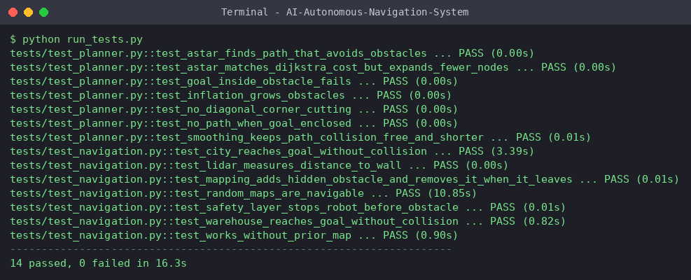
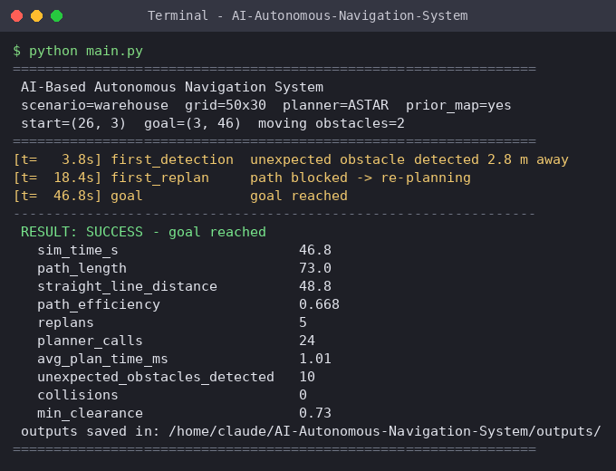
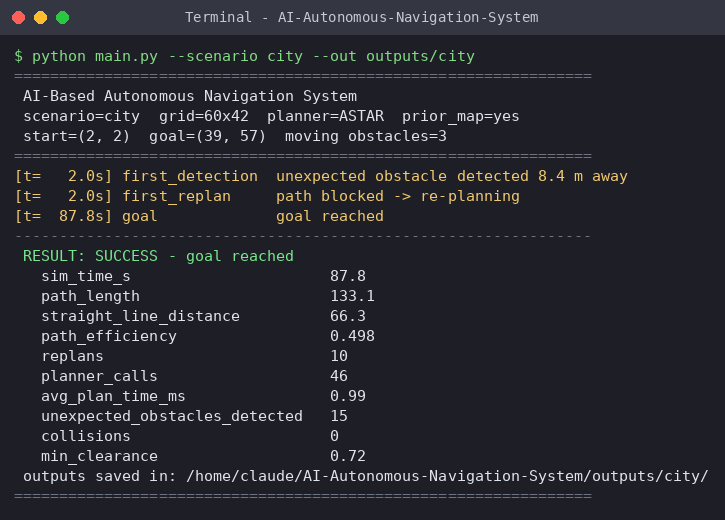
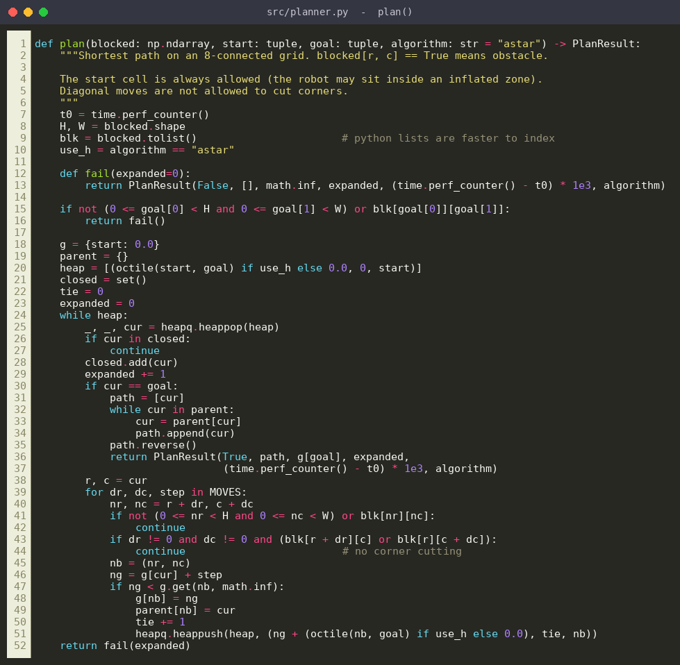

# 🤖 AI-Based Autonomous Navigation System

A robot that navigates a virtual warehouse and city **with no human control**: it senses its surroundings with a simulated LiDAR, builds a map, detects obstacles it was never told about, plans routes with **A\***, re-plans when the world changes, and stops itself before a collision.



| | Warehouse | City |
|---|---|---|
| Result | ✅ goal reached | ✅ goal reached |
| Collisions | **0** | **0** |
| Unexpected obstacles found | 10 | 15 |
| Re-plans | 5 | 10 |
| Avg planning time | 0.84 ms | 1.07 ms |

*(seed 7 - reproduce with the commands below; numbers come from `outputs/metrics.json`)*

## Why this matters
Autonomous vehicles, warehouse AMRs, delivery robots and drones all run the same loop: **perceive → map → plan → act → stay safe**. Real maps are never perfect - boxes get left in aisles, people walk across roads - so a navigation stack must handle things it did not expect. This project implements that loop end to end, in simulation, with tests.

## What it does
- **Simulated LiDAR** (90 noisy rays) - the robot never sees the ground truth.
- **Occupancy-grid mapping** (log-odds) - adds new obstacles *and removes ones that moved away*.
- **OpenCV obstacle detection + tracking** - finds blobs not in the prior map and labels them `STATIC` / `MOVING`.
- **A\* global planner** (8-connected, octile heuristic, no corner cutting) + line-of-sight path smoothing.
- **Re-planning** when the path is blocked; periodic shortcut check.
- **Pure-pursuit controller** for a differential-drive (unicycle) robot.
- **Reactive safety layer** - emergency stop and turn-away, overrides the planner.
- **Three worlds**: `warehouse`, `city`, and seeded `random` maps. Runs with or without a prior map.
- **Dashboard, GIF, trajectory + telemetry plots, JSON metrics.**

## Architecture
```
LiDAR scan → Occupancy map + OpenCV detection → Decision (state machine) → A* + smoothing
                                                     ↑                         ↓
                          Robot dynamics ← Safety layer ← Pure-pursuit controller
```
Full diagram and data flow: [`docs/ARCHITECTURE.md`](docs/ARCHITECTURE.md)

## Folder structure
```
AI-Autonomous-Navigation-System/
├── main.py              # run a simulation (CLI)
├── benchmark.py         # A* vs Dijkstra on random maps
├── requirements.txt
├── src/
│   ├── config.py        # all tunable parameters
│   ├── world.py         # scenarios, moving obstacles
│   ├── sensors.py       # simulated LiDAR
│   ├── perception.py    # occupancy grid + OpenCV detection
│   ├── planner.py       # A*, Dijkstra, smoothing
│   ├── controller.py    # pure pursuit
│   ├── agent.py         # decision-making state machine
│   ├── simulation.py    # main loop + metrics
│   └── visualizer.py    # dashboard / GIF / plots
├── tests/               # 14 pytest tests
├── docs/                # architecture, hardware roadmap, GitHub + interview guide
├── screenshots/         # proof images for README / GitHub / LinkedIn
└── outputs/             # GIFs, screenshots, metrics (generated)
```

## Installation
Python 3.9+ (tested on 3.12). No GPU needed.

**Windows**
```bat
git clone https://github.com/<your-username>/AI-Autonomous-Navigation-System.git
cd AI-Autonomous-Navigation-System
python -m venv venv
venv\Scripts\activate
pip install -r requirements.txt
```
**Mac / Linux**
```bash
git clone https://github.com/<your-username>/AI-Autonomous-Navigation-System.git
cd AI-Autonomous-Navigation-System
python3 -m venv venv && source venv/bin/activate
pip install -r requirements.txt
```
Check: `python -c "import cv2, numpy, matplotlib; print('OK')"`

## How to run
```bash
python main.py                              # warehouse demo → outputs/
python main.py --scenario city --out outputs/city
python main.py --scenario random --seed 3
python main.py --live                       # live window instead of headless
python main.py --no-prior                   # robot starts with NO map
python main.py --algorithm dijkstra         # swap planner
python benchmark.py                         # planner comparison chart
python run_tests.py                         # run tests (or: python -m pytest -q)
python tools/make_screenshots.py            # regenerate terminal + code screenshots
```
Sample terminal output:
```
[t=   3.8s] first_detection  unexpected obstacle detected 2.8 m away
[t=  18.4s] first_replan     path blocked -> re-planning
[t=  46.8s] goal             goal reached
 RESULT: SUCCESS - goal reached
   path_length                     73.0
   replans                         5
   unexpected_obstacles_detected   10
   collisions                      0
```

## Results
| Detection | Re-planning | Final run |
|---|---|---|
|  |  |  |

**Telemetry** (speed, clearance, agent state): 

**A\* vs Dijkstra** - same path cost, **51% fewer nodes expanded** (30 random maps): 


### Terminal proof (real runs - raw text in [`terminal_logs/`](terminal_logs))
| Tests (14 passed) | Warehouse run | City run |
|---|---|---|
|  |  |  |

More: [install check](screenshots/terminal/01_install_check.png) · [random map](screenshots/terminal/05_run_random_seed3.png) · [no prior map](screenshots/terminal/06_run_no_prior_map.png) · [Dijkstra](screenshots/terminal/07_run_dijkstra.png) · [benchmark](screenshots/terminal/08_benchmark.png)

### Code highlights
[A\* planner](screenshots/code/01_astar_planner.png) · [decision + safety layer](screenshots/code/02_decision_and_safety_layer.png) · [occupancy mapping](screenshots/code/03_occupancy_mapping.png) · [OpenCV detection](screenshots/code/04_opencv_obstacle_detection.png) · [pure pursuit](screenshots/code/05_pure_pursuit_controller.png) · [LiDAR simulation](screenshots/code/06_lidar_simulation.png) · [simulation loop](screenshots/code/07_simulation_loop.png) · [tests](screenshots/code/08_planner_tests.png)



City scenario screenshots: `screenshots/city_*.png` · GIF: [`screenshots/navigation_demo_city.gif`](screenshots/navigation_demo_city.gif)

## Limitations (honest)
2D grid world; range sensing only (no camera, so no YOLO / lane detection yet); an obstacle that leaves sensor range can leave a stale "ghost" in the map until re-observed.

## Future improvements
1. Camera + YOLOv8 detection in a 3D simulator (CARLA / Gazebo)  2. ROS 2 nodes per module  3. SLAM instead of a prior map  4. D\* Lite for faster re-planning  5. Reinforcement-learning local planner  6. Multiple robots  7. Real hardware via [`docs/HARDWARE_ROADMAP.md`](docs/HARDWARE_ROADMAP.md).

## What I learned
Occupancy-grid mapping, graph search (A\*), sensor simulation, state machines for robot behaviour, layering reactive safety over deliberative planning, writing testable robotics code.

## Author
**<Your Name>** - <your degree / college> · [LinkedIn](https://linkedin.com/in/<you>) · [GitHub](https://github.com/<you>)

MIT License
